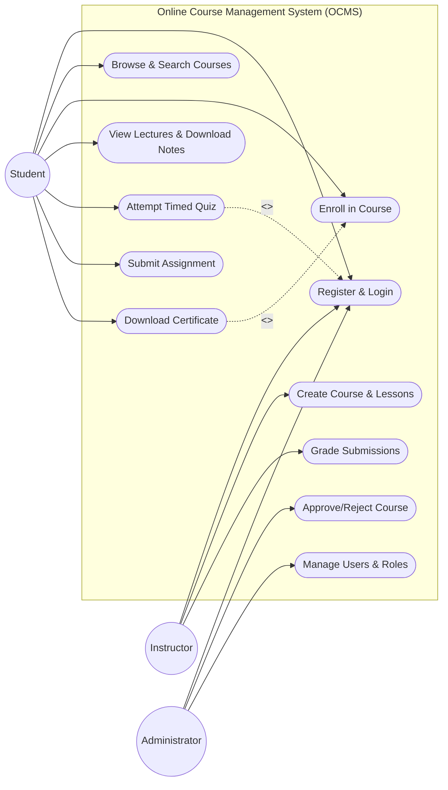
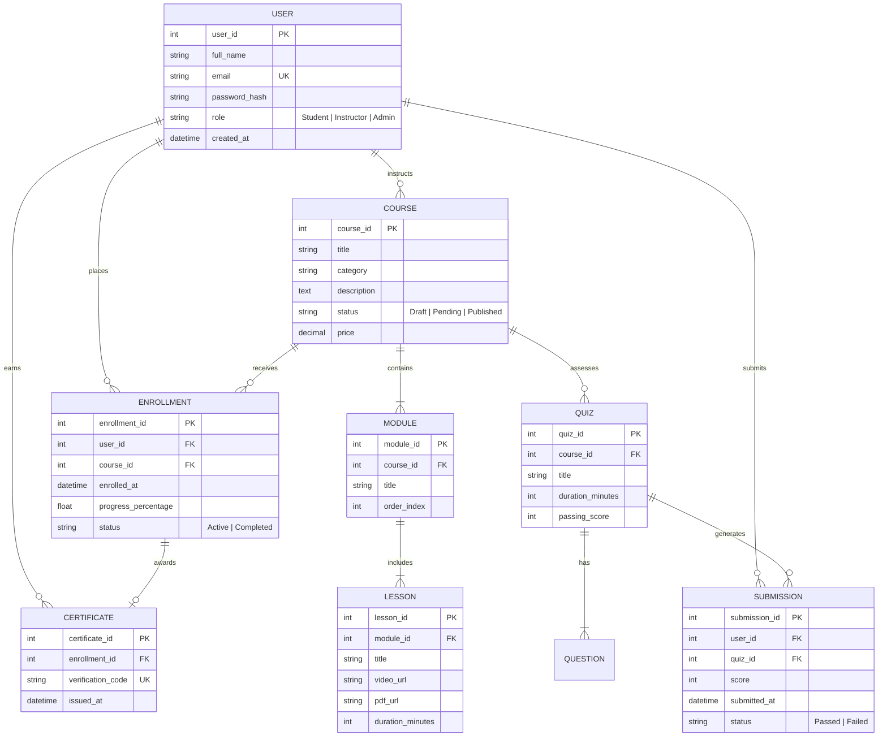
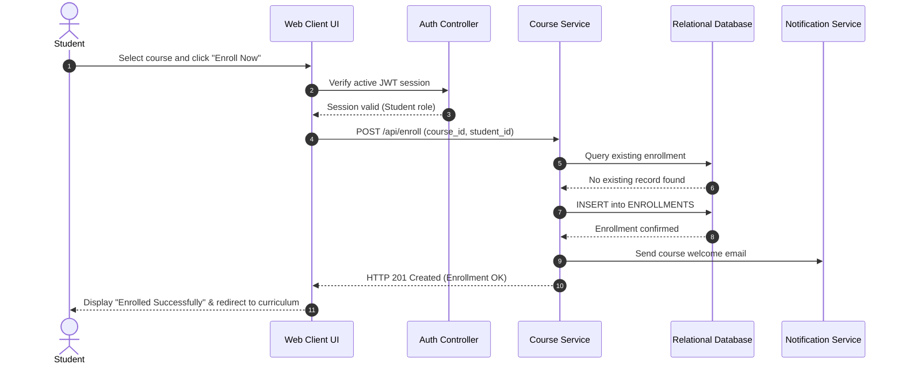

# System Modelling Diagrams

This directory contains UML and architectural models for the **Online Course Management System (OCMS)** developed during the laboratory modelling sessions.

---

## 1. Use Case Diagram

---

## 2. Entity Relationship Diagram (ERD)

---

## 3. Sequence Diagram: Course Enrollment & Assessment Flow

